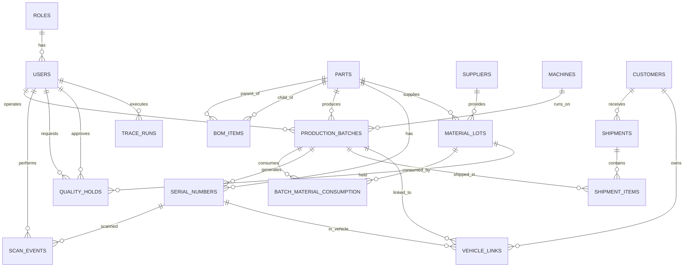

# 🗄️ TraceIntel AG-1 — Database Design Plan

## ER Diagram (Entity Relationship)



---

## Table Relationships (Simple Explanation)

### 🔗 The Trace Chain (MOST IMPORTANT)

```
This is how data flows through the factory:

SUPPLIER ──delivers──▶ MATERIAL_LOT ──consumed_by──▶ PRODUCTION_BATCH ──produces──▶ SERIAL_NUMBER
                                                            │
                                                            ▼
                                                     SHIPMENT_ITEM ──part_of──▶ SHIPMENT ──sent_to──▶ CUSTOMER
                                                            │
                                                            ▼
                                                      VEHICLE_LINK ──installed_in──▶ VIN (Gaadi)
```

**Yeh chain trace kaise kaam karta hai:**
- **Forward**: Lot dhundho → kis batch ne use kiya → wo batch kahan gaya → kis customer ko → kaunsi gaadi mein
- **Backward**: VIN dhundho → kis batch se aaya → wo batch kis lot se bana → kaunsa supplier

---

## All 18 Tables — Detailed

### Table 1: `roles`
| Column | Type | Constraint | Example |
|--------|------|-----------|---------|
| id | BIGSERIAL | PRIMARY KEY | 1 |
| name | VARCHAR(30) | UNIQUE, NOT NULL | ADMIN |
| description | VARCHAR(255) | | System administrator |
| created_at | TIMESTAMP | DEFAULT NOW() | 2026-10-27 10:00:00 |
| updated_at | TIMESTAMP | DEFAULT NOW() | 2026-10-27 10:00:00 |

**Rows**: Always 5 (ADMIN, OPERATOR, SUPERVISOR, QUALITY_ENGINEER, MANAGER)

---

### Table 2: `users`
| Column | Type | Constraint | Example |
|--------|------|-----------|---------|
| id | BIGSERIAL | PRIMARY KEY | 1 |
| username | VARCHAR(50) | UNIQUE, NOT NULL | operator1 |
| password_hash | VARCHAR(255) | NOT NULL | $2a$10$abc... (bcrypt) |
| full_name | VARCHAR(100) | NOT NULL | Rajesh Kumar |
| email | VARCHAR(100) | UNIQUE | rajesh@motherson.com |
| role_id | BIGINT | FK → roles(id) | 2 (OPERATOR) |
| active | BOOLEAN | DEFAULT TRUE | true |

**Relationship**: Each user has exactly 1 role

---

### Table 3: `suppliers`
| Column | Type | Constraint | Example |
|--------|------|-----------|---------|
| id | BIGSERIAL | PRIMARY KEY | 1 |
| code | VARCHAR(20) | UNIQUE, NOT NULL | SUP-TSL |
| name | VARCHAR(150) | NOT NULL | Tata Steel Ltd |
| contact_email | VARCHAR(100) | | procurement@tatasteel.com |
| phone | VARCHAR(30) | | +91-22-66658282 |
| address | TEXT | | Mumbai, Maharashtra |

---

### Table 4: `customers`
| Column | Type | Constraint | Example |
|--------|------|-----------|---------|
| id | BIGSERIAL | PRIMARY KEY | 1 |
| code | VARCHAR(20) | UNIQUE, NOT NULL | MARUTI |
| name | VARCHAR(150) | NOT NULL | Maruti Suzuki India Ltd |
| contact_email | VARCHAR(100) | | vendor@maruti.co.in |
| phone | VARCHAR(30) | | +91-124-4781000 |
| address | TEXT | | Gurugram, Haryana |

---

### Table 5: `machines`
| Column | Type | Constraint | Example |
|--------|------|-----------|---------|
| id | BIGSERIAL | PRIMARY KEY | 1 |
| code | VARCHAR(20) | UNIQUE, NOT NULL | IM-001 |
| name | VARCHAR(100) | NOT NULL | Injection Molding Machine 1 |
| station | VARCHAR(50) | | Station-A |
| location | VARCHAR(100) | | Building 2, Floor 1 |
| active | BOOLEAN | DEFAULT TRUE | true |

---

### Table 6: `parts`
| Column | Type | Constraint | Example |
|--------|------|-----------|---------|
| id | BIGSERIAL | PRIMARY KEY | 1 |
| part_number | VARCHAR(50) | UNIQUE, NOT NULL | MTH-DH-001 |
| name | VARCHAR(150) | NOT NULL | Door Handle Assembly |
| description | TEXT | | Left-side exterior door handle |
| cost_per_part | NUMERIC(12,2) | DEFAULT 0 | 300.00 |
| parts_per_vehicle | INTEGER | DEFAULT 1 | 4 |
| scrap_cost | NUMERIC(12,2) | DEFAULT 0 | 50.00 |
| rework_cost | NUMERIC(12,2) | DEFAULT 0 | 30.00 |

**Used in**: Estimate calculation → Loss = (parts × cost) + scrap + rework

---

### Table 7: `bom_items` (Bill of Materials)
| Column | Type | Constraint | Example |
|--------|------|-----------|---------|
| id | BIGSERIAL | PRIMARY KEY | 1 |
| parent_part_id | BIGINT | FK → parts(id) | 1 (Door Handle Assembly) |
| child_part_id | BIGINT | FK → parts(id) | 5 (Steel Sheet) |
| quantity | NUMERIC(10,3) | DEFAULT 1 | 2.000 |
| level | INTEGER | DEFAULT 1 | 1 |

**What it means**: Door Handle Assembly is MADE FROM Steel Sheet (qty 2)
**Unique constraint**: (parent_part_id, child_part_id) — same combo can't repeat

```
BOM Example:
Door Handle Assembly (parent)
├── Steel Sheet (child, qty: 2, level 1)
├── Plastic Cover (child, qty: 1, level 1)
└── Mounting Screws (child, qty: 6, level 1)
```

---

### Table 8: `material_lots` ⭐
| Column | Type | Constraint | Example |
|--------|------|-----------|---------|
| id | BIGSERIAL | PRIMARY KEY | 5 |
| lot_number | VARCHAR(50) | UNIQUE, NOT NULL | LOT-STL-2026-005 |
| supplier_id | BIGINT | FK → suppliers(id) | 1 (Tata Steel) |
| part_id | BIGINT | FK → parts(id) | 5 (Steel Sheet) |
| received_date | DATE | NOT NULL | 2026-10-10 |
| expiry_date | DATE | | 2027-10-10 |
| status | VARCHAR(20) | NOT NULL, DEFAULT 'OK' | OK / ON_HOLD / REJECTED |
| quantity | NUMERIC(12,2) | | 5000.00 |
| unit | VARCHAR(20) | DEFAULT 'pcs' | kg |

**Key field**: `status` — this is what gets checked during scan and changed during hold approval

---

### Table 9: `production_batches`
| Column | Type | Constraint | Example |
|--------|------|-----------|---------|
| id | BIGSERIAL | PRIMARY KEY | 3 |
| batch_number | VARCHAR(50) | UNIQUE, NOT NULL | B-2026-003 |
| part_id | BIGINT | FK → parts(id) | 1 (Door Handle) |
| machine_id | BIGINT | FK → machines(id) | 1 (IM-001) |
| operator_id | BIGINT | FK → users(id) | 3 (operator1) |
| shift | VARCHAR(20) | DEFAULT 'DAY' | DAY / NIGHT / GENERAL |
| start_time | TIMESTAMP | NOT NULL | 2026-10-15 08:00:00 |
| end_time | TIMESTAMP | | 2026-10-15 16:00:00 |
| quantity | INTEGER | DEFAULT 0 | 500 |

---

### Table 10: `batch_material_consumption` ⭐⭐ (TRACE KEY TABLE)
| Column | Type | Constraint | Example |
|--------|------|-----------|---------|
| id | BIGSERIAL | PRIMARY KEY | 1 |
| batch_id | BIGINT | FK → production_batches(id) | 3 (B-2026-003) |
| lot_id | BIGINT | FK → material_lots(id) | 5 (LOT-STL-2026-005) |
| quantity_used | NUMERIC(12,2) | | 1000.00 |
| recorded_at | TIMESTAMP | DEFAULT NOW() | 2026-10-15 08:05:00 |

**What it means**: Batch B-2026-003 used material from Lot LOT-STL-2026-005
**This link is created when**: Operator scans material lot at batch start
**Unique constraint**: (batch_id, lot_id)
**Index**: `idx_bmc_lot` on lot_id — for fast forward trace

---

### Table 11: `serial_numbers`
| Column | Type | Constraint | Example |
|--------|------|-----------|---------|
| id | BIGSERIAL | PRIMARY KEY | 42 |
| serial | VARCHAR(100) | UNIQUE, NOT NULL | MTH-DH-001-00042 |
| part_id | BIGINT | FK → parts(id) | 1 (Door Handle) |
| batch_id | BIGINT | FK → production_batches(id) | 3 (B-2026-003) |
| produced_at | TIMESTAMP | DEFAULT NOW() | 2026-10-15 10:30:00 |

**Unique constraint**: `serial` — same serial CANNOT exist twice (duplicate prevention)

---

### Table 12: `scan_events`
| Column | Type | Constraint | Example |
|--------|------|-----------|---------|
| id | BIGSERIAL | PRIMARY KEY | 156 |
| serial_number_id | BIGINT | FK → serial_numbers(id) | 42 |
| serial_input | VARCHAR(100) | NOT NULL | MTH-DH-001-00042 |
| batch_id | BIGINT | FK → production_batches(id) | 3 |
| operator_id | BIGINT | FK → users(id) | 3 (operator1) |
| station | VARCHAR(50) | | Assembly-A1 |
| result | VARCHAR(20) | NOT NULL | ACCEPTED / BLOCKED |
| reason | TEXT | | null (if accepted) / "WRONG_PART" |
| manual_entry | BOOLEAN | DEFAULT FALSE | false |
| approved_by | BIGINT | FK → users(id) | null (unless manual) |
| scanned_at | TIMESTAMP | DEFAULT NOW() | 2026-10-15 10:30:05 |

**Every scan is saved** — whether ACCEPTED or BLOCKED

---

### Table 13: `shipments`
| Column | Type | Constraint | Example |
|--------|------|-----------|---------|
| id | BIGSERIAL | PRIMARY KEY | 1 |
| shipment_number | VARCHAR(50) | UNIQUE, NOT NULL | SH-2026-001 |
| customer_id | BIGINT | FK → customers(id) | 1 (Maruti) |
| shipped_date | DATE | NOT NULL | 2026-10-20 |
| notes | TEXT | | Regular weekly dispatch |

---

### Table 14: `shipment_items` ⭐ (TRACE KEY TABLE)
| Column | Type | Constraint | Example |
|--------|------|-----------|---------|
| id | BIGSERIAL | PRIMARY KEY | 1 |
| shipment_id | BIGINT | FK → shipments(id) | 1 (SH-2026-001) |
| batch_id | BIGINT | FK → production_batches(id) | 3 (B-2026-003) |
| quantity | INTEGER | DEFAULT 0 | 500 |

**What it means**: Shipment SH-2026-001 carried Batch B-2026-003
**This link is created when**: Batch is scanned at dispatch
**Unique constraint**: (shipment_id, batch_id)
**Index**: `idx_shipment_items_batch` — for fast trace

---

### Table 15: `vehicle_links` ⭐ (TRACE KEY TABLE)
| Column | Type | Constraint | Example |
|--------|------|-----------|---------|
| id | BIGSERIAL | PRIMARY KEY | 1 |
| vin | VARCHAR(17) | NOT NULL | MA3FJEB1S00123456 |
| batch_id | BIGINT | FK → production_batches(id) | 3 |
| serial_number_id | BIGINT | FK → serial_numbers(id) | 42 |
| customer_id | BIGINT | FK → customers(id) | 1 (Maruti) |
| imported_at | TIMESTAMP | DEFAULT NOW() | 2026-10-25 |

**What it means**: VIN MA3FJ...456 used parts from Batch B-2026-003
**This data comes from**: CSV import (OEM sends this data)
**Index**: `idx_vehicle_links_vin` + `idx_vehicle_links_batch`

---

### Table 16: `quality_holds` ⭐
| Column | Type | Constraint | Example |
|--------|------|-----------|---------|
| id | BIGSERIAL | PRIMARY KEY | 1 |
| lot_id | BIGINT | FK → material_lots(id) | 5 |
| requested_by | BIGINT | FK → users(id) | 5 (Priya) |
| request_reason | TEXT | NOT NULL | Failed tensile strength test |
| status | VARCHAR(20) | DEFAULT 'REQUESTED' | REQUESTED / APPROVED / REJECTED |
| approved_by | BIGINT | FK → users(id) | 6 (Vikram) |
| approval_notes | TEXT | | Confirmed. Quarantine immediately. |
| requested_at | TIMESTAMP | DEFAULT NOW() | 2026-10-27 14:00:00 |
| resolved_at | TIMESTAMP | | 2026-10-27 14:30:00 |

**Two-person rule**: `requested_by ≠ approved_by` (enforced in Java code)

---

### Table 17: `trace_runs`
| Column | Type | Constraint | Example |
|--------|------|-----------|---------|
| id | BIGSERIAL | PRIMARY KEY | 1 |
| lot_id | BIGINT | FK → material_lots(id) | 5 |
| direction | VARCHAR(10) | DEFAULT 'FORWARD' | FORWARD / BACKWARD |
| input_value | VARCHAR(100) | | LOT-STL-2026-005 |
| result_json | TEXT | | {"batches":[...], "customers":[...]} |
| duration_ms | BIGINT | NOT NULL | 47 |
| executed_by | BIGINT | FK → users(id) | 5 (Priya) |
| executed_at | TIMESTAMP | DEFAULT NOW() | 2026-10-27 15:00:00 |

**Measures**: How long the trace took (for demo: "Completed in 47ms")

---

### Bonus: `audit_logs`
| Column | Type | Example |
|--------|------|---------|
| id | BIGSERIAL | 1 |
| user_id | FK → users(id) | 1 (admin) |
| action | VARCHAR(50) | CREATE_PART |
| entity_type | VARCHAR(50) | Part |
| entity_id | BIGINT | 1 |
| details | TEXT | Created part MTH-DH-001 |
| ip_address | VARCHAR(45) | 192.168.1.100 |
| created_at | TIMESTAMP | 2026-10-27 10:00:00 |

---

## Index Strategy (Performance ke liye)

| Index | Table | Column | Kyun Zaroori Hai |
|-------|-------|--------|-----------------|
| `idx_bmc_lot` | batch_material_consumption | lot_id | Forward trace: lot se batches dhundho — FAST |
| `idx_bmc_batch` | batch_material_consumption | batch_id | Backward trace: batch se lot dhundho |
| `idx_shipment_items_batch` | shipment_items | batch_id | Trace: batch se shipment dhundho |
| `idx_shipment_items_shipment` | shipment_items | shipment_id | Shipment detail page |
| `idx_serial_numbers_serial` | serial_numbers | serial | Scan validation: serial se part dhundho — FAST |
| `idx_serial_numbers_batch` | serial_numbers | batch_id | Batch ki saari serials |
| `idx_scan_events_batch` | scan_events | batch_id | Batch ke saare scans |
| `idx_material_lots_status` | material_lots | status | ON_HOLD lots filter |
| `idx_vehicle_links_vin` | vehicle_links | vin | Backward trace from VIN — FAST |
| `idx_vehicle_links_batch` | vehicle_links | batch_id | Forward trace to VINs |
| `idx_quality_holds_lot` | quality_holds | lot_id | Lot ke holds dhundho |
| `idx_audit_logs_user` | audit_logs | user_id | User ki activity |
| `idx_audit_logs_entity` | audit_logs | (entity_type, entity_id) | Entity ki history |

---

## The Core Trace Query (Explained Step by Step)

```sql
-- FORWARD TRACE: Lot 5 defective hai, kya affected hua?

-- Step 1: Kaunse batches ne yeh lot use kiya?
SELECT b.batch_number, b.quantity
FROM batch_material_consumption bmc
JOIN production_batches b ON b.id = bmc.batch_id
WHERE bmc.lot_id = 5;
-- Result: B-2026-003 (500 pcs), B-2026-007 (300 pcs)

-- Step 2: Yeh batches kaunsi shipment mein gaye?
SELECT s.shipment_number, c.name as customer_name, s.shipped_date
FROM shipment_items si
JOIN shipments s ON s.id = si.shipment_id
JOIN customers c ON c.id = s.customer_id
WHERE si.batch_id IN (3, 7);
-- Result: SH-2026-001 → Maruti Suzuki → 20-Oct-2026

-- Step 3: Kaunsi gaadiyaan affected hain?
SELECT vl.vin
FROM vehicle_links vl
WHERE vl.batch_id IN (3, 7);
-- Result: MA3FJEB1S00123456, MA3FJEB1S00123457, MA3FJEB1S00123458

-- COMBINED (single query):
SELECT
    b.batch_number,
    b.quantity,
    s.shipment_number,
    c.name as customer_name,
    s.shipped_date,
    vl.vin
FROM batch_material_consumption bmc
JOIN production_batches b ON b.id = bmc.batch_id
LEFT JOIN shipment_items si ON si.batch_id = b.id
LEFT JOIN shipments s ON s.id = si.shipment_id
LEFT JOIN customers c ON c.id = s.customer_id
LEFT JOIN vehicle_links vl ON vl.batch_id = b.id
WHERE bmc.lot_id = 5;
```

> **Interview mein explain karo**: "LEFT JOIN isliye use kiya kyunki kuch batches abhi shipped nahi hui — wo bhi dikhne chahiye as in-factory batches"
