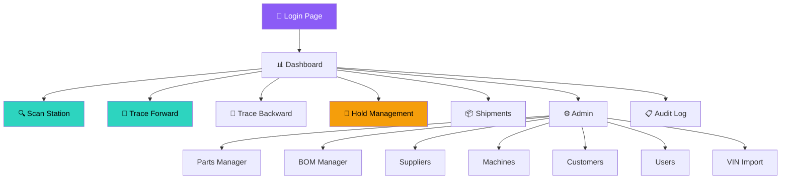

# 🎨 TraceIntel AG-1 — Frontend UI/UX Plan

## Design Philosophy

| Principle | Implementation |
|-----------|---------------|
| **Dark Industrial Theme** | Near-black backgrounds (#0a0a0f), teal/purple accents |
| **Glassmorphism** | Cards with backdrop-blur, semi-transparent borders |
| **Motion Design** | Framer Motion — fade-up on scroll, page transitions |
| **Data First** | Big numbers, clear tables, instant feedback |
| **Responsive** | Works on 1920px desktop down to 768px tablet |

---

## Navigation Flow



---

## Sidebar Menu (Role-Based)

```
┌─────────────────────────┐
│  🏭 TraceIntel AG-1     │  ← Logo + name
│─────────────────────────│
│                         │
│  📊 Dashboard           │  ← ALL roles
│  🔍 Scan Station        │  ← OPERATOR, SUPERVISOR, ADMIN
│  📦 Shipments           │  ← OPERATOR, SUPERVISOR, ADMIN
│                         │
│  ── TRACE ──            │
│  🔎 Forward Trace       │  ← QE, MANAGER, SUPERVISOR, ADMIN
│  🔎 Backward Trace      │  ← QE, MANAGER, SUPERVISOR, ADMIN
│                         │
│  ── QUALITY ──          │
│  🛑 Hold Management     │  ← QE, MANAGER, SUPERVISOR, ADMIN
│                         │
│  ── ADMIN ──            │  ← ADMIN only
│  ⚙️ Parts               │
│  📋 BOM                 │
│  🏢 Suppliers           │
│  🖥️ Machines            │
│  👥 Customers           │
│  👤 Users               │
│  📥 VIN Import          │
│                         │
│  📋 Audit Log           │  ← ADMIN, MANAGER
│                         │
│─────────────────────────│
│  👤 Rajesh Kumar        │  ← User name
│  🔵 OPERATOR            │  ← Role badge
│  🚪 Logout              │
└─────────────────────────┘
```

---

## Page Wireframes

### Page 1: Login Page (`/login`)
```
┌──────────────────────────────────────────────────────────┐
│                                                          │
│              Background: Dark with subtle                │
│              radial gradient (purple glow)                │
│                                                          │
│         ┌─────────────────────────────────┐              │
│         │                                 │              │
│         │    🏭 TraceIntel AG-1           │              │
│         │    Manufacturing Traceability    │              │
│         │                                 │              │
│         │    ┌─────────────────────────┐  │              │
│         │    │ 👤 Username             │  │              │
│         │    └─────────────────────────┘  │              │
│         │    ┌─────────────────────────┐  │              │
│         │    │ 🔒 Password             │  │              │
│         │    └─────────────────────────┘  │              │
│         │                                 │              │
│         │    ┌─────────────────────────┐  │              │
│         │    │      🔐 Sign In         │  │ ← Teal glow │
│         │    └─────────────────────────┘  │              │
│         │                                 │              │
│         │    Glassmorphic card with       │              │
│         │    backdrop blur               │              │
│         └─────────────────────────────────┘              │
│                                                          │
└──────────────────────────────────────────────────────────┘
```

---

### Page 2: Dashboard (`/dashboard`)
```
┌──────────────────────────────────────────────────────────────────────┐
│ Sidebar │ TopBar: Dashboard          👤 Rajesh Kumar  🔵 OPERATOR   │
│─────────│────────────────────────────────────────────────────────────│
│         │                                                            │
│ 📊 Dash │  ┌──────────┐ ┌──────────┐ ┌──────────┐ ┌──────────┐    │
│ 🔍 Scan │  │ Total    │ │ Scans   │ │ Blocked │ │ Active  │    │
│ 📦 Ship │  │ Batches  │ │ Today   │ │ Today   │ │ Holds   │    │
│         │  │          │ │         │ │         │ │         │    │
│ 🔎 Trace│  │  ↗ 247   │ │ ↗ 1,834 │ │  ⚠ 12   │ │  🔴 3   │    │
│ 🛑 Hold │  │ (counter │ │(counter │ │(counter │ │(counter │    │
│         │  │ animates)│ │animates)│ │animates)│ │animates)│    │
│ ⚙️ Admin│  └──────────┘ └──────────┘ └──────────┘ └──────────┘    │
│         │                                                            │
│         │  ┌────────────────────────┐ ┌────────────────────────┐    │
│         │  │  📈 Scan Activity      │ │  🍩 Block Reasons      │    │
│         │  │  (7-day Area Chart)    │ │  (Donut Chart)         │    │
│         │  │                        │ │  ■ Wrong Part: 45%     │    │
│         │  │  ████▓▓▓               │ │  ■ Lot On Hold: 30%   │    │
│         │  │  ███████▓▓▓            │ │  ■ Duplicate: 25%     │    │
│         │  └────────────────────────┘ └────────────────────────┘    │
│         │                                                            │
│         │  ┌────────────────────────────────────────────────────┐    │
│         │  │  Recent Scan Events                                │    │
│         │  │──────────────────────────────────────────────────── │    │
│         │  │  Serial         │ Part        │ Result │ Time     │    │
│         │  │  MTH-DH-001-042 │ Door Handle │ ✅ ACC │ 10:30am │    │
│         │  │  MTH-WH-002-015 │ Wiring Har. │ ❌ BLK │ 10:28am │    │
│         │  │  MTH-DH-001-041 │ Door Handle │ ✅ ACC │ 10:25am │    │
│         │  └────────────────────────────────────────────────────┘    │
│         │                                                            │
└──────────────────────────────────────────────────────────────────────┘
```

---

### Page 3: Scan Station (`/scan`) ⭐ HERO PAGE
```
┌──────────────────────────────────────────────────────────────────────┐
│ Sidebar │ TopBar: Scan Station                                       │
│─────────│────────────────────────────────────────────────────────────│
│         │                                                            │
│         │  ┌────────────────────────────────────────────────────┐    │
│         │  │                                                    │    │
│         │  │   🔍 SCAN PART                                    │    │
│         │  │                                                    │    │
│         │  │   Production Batch:  [ B-2026-003 ▼ ]             │    │
│         │  │   Station:           [ Assembly-A1 ▼ ]             │    │
│         │  │                                                    │    │
│         │  │   ┌────────────────────────────────────────┐      │    │
│         │  │   │                                        │      │    │
│         │  │   │  Enter or scan serial number...        │      │    │
│         │  │   │                                        │      │    │
│         │  │   └────────────────────────────────────────┘      │    │
│         │  │                                                    │    │
│         │  │   [📷 Camera Scan]     [⌨️ Submit]                │    │
│         │  │   [☑️ Manual Entry — requires supervisor approval]  │    │
│         │  │                                                    │    │
│         │  └────────────────────────────────────────────────────┘    │
│         │                                                            │
│         │  ┌────────────────────────────────────────────────────┐    │
│         │  │                                                    │    │
│         │  │         ✅ ACCEPTED                                │    │
│         │  │                                                    │    │
│         │  │   Serial: MTH-DH-001-00042                        │    │
│         │  │   Part:   Door Handle Assembly                     │    │
│         │  │   Batch:  B-2026-003                              │    │
│         │  │                                                    │    │
│         │  │   ✓ Part validated successfully                   │    │
│         │  │                                                    │    │
│         │  │   (Green glow border, check animation)             │    │
│         │  └────────────────────────────────────────────────────┘    │
│         │                                                            │
│         │  ── OR if BLOCKED: ──                                     │
│         │                                                            │
│         │  ┌────────────────────────────────────────────────────┐    │
│         │  │                                                    │    │
│         │  │         ❌ BLOCKED                                 │    │
│         │  │                                                    │    │
│         │  │   Serial: MTH-WH-002-00015                        │    │
│         │  │   Part:   Wiring Harness                          │    │
│         │  │                                                    │    │
│         │  │   ⚠ WRONG PART: Part 'Wiring Harness' is not     │    │
│         │  │   in BOM for batch B-2026-003 (expected: Door     │    │
│         │  │   Handle Assembly)                                 │    │
│         │  │                                                    │    │
│         │  │   (Red glow border, shake animation)               │    │
│         │  └────────────────────────────────────────────────────┘    │
│         │                                                            │
└──────────────────────────────────────────────────────────────────────┘
```

---

### Page 4: Forward Trace (`/trace`) ⭐
```
┌──────────────────────────────────────────────────────────────────────┐
│ Sidebar │ TopBar: Forward Trace                                      │
│─────────│────────────────────────────────────────────────────────────│
│         │                                                            │
│         │  ┌─────────────────────────────────────┐                  │
│         │  │  Select Defective Lot:              │                  │
│         │  │  [ LOT-STL-2026-005  ▼ ]            │                  │
│         │  │                                     │                  │
│         │  │  [ 🔍 TRACE ]  ← Big teal button    │                  │
│         │  └─────────────────────────────────────┘                  │
│         │                                                            │
│         │  ⏱️ Trace completed in 47ms                               │
│         │                                                            │
│         │  ┌─── Affected Batches ──────────────────────────────┐    │
│         │  │ Batch       │ Part         │ Qty │ Status        │    │
│         │  │ B-2026-003  │ Door Handle  │ 500 │ 📦 Shipped    │    │
│         │  │ B-2026-007  │ Door Handle  │ 300 │ 🏭 In Factory │    │
│         │  └──────────────────────────────────────────────────  │    │
│         │                                                            │
│         │  ┌─── Affected Customers ────────────────────────────┐    │
│         │  │ Customer              │ Shipment    │ Date        │    │
│         │  │ Maruti Suzuki India   │ SH-2026-001 │ 20-Oct-2026│    │
│         │  └───────────────────────────────────────────────────│    │
│         │                                                            │
│         │  ┌─── Affected VINs ─────────────────────────────────┐    │
│         │  │ MA3FJEB1S00123456                                 │    │
│         │  │ MA3FJEB1S00123457                                 │    │
│         │  │ MA3FJEB1S00123458                                 │    │
│         │  └───────────────────────────────────────────────────│    │
│         │                                                            │
│         │  ┌─── Estimates ─────────────────────────────────────┐    │
│         │  │ Total Affected Parts:  800                        │    │
│         │  │ Estimated Vehicles:    800                         │    │
│         │  │ Parts Cost:            ₹2,40,000                  │    │
│         │  │ Scrap Cost:            ₹40,000                    │    │
│         │  │ Rework Cost:           ₹24,000                    │    │
│         │  │ TOTAL ESTIMATED LOSS:  ₹3,04,000                  │    │
│         │  │ ⚠️ These are estimates, not certain predictions    │    │
│         │  └───────────────────────────────────────────────────│    │
└──────────────────────────────────────────────────────────────────────┘
```

---

### Page 5: Hold Management (`/holds`) ⭐
```
┌──────────────────────────────────────────────────────────────────────┐
│ Sidebar │ TopBar: Hold Management                                    │
│─────────│────────────────────────────────────────────────────────────│
│         │                                                            │
│         │  [ + Request New Hold ]   ← Button                        │
│         │                                                            │
│         │  ┌─── Pending Approvals ─────────────────────────────┐    │
│         │  │ Lot             │ Requested By │ Reason   │ Action│    │
│         │  │ LOT-STL-2026-005│ Priya Sharma │ Failed.. │[✅][❌]│   │
│         │  └───────────────────────────────────────────────────│    │
│         │                                                            │
│         │  ┌─── Hold History ──────────────────────────────────┐    │
│         │  │ Lot             │ Status    │ By      │ Approved │    │
│         │  │ LOT-PLY-2026-002│ ✅ APPROVED│ Amit    │ Vikram  │    │
│         │  │ LOT-RUB-2026-001│ ❌ REJECTED│ Suresh  │ Vikram  │    │
│         │  └───────────────────────────────────────────────────│    │
│         │                                                            │
│         │  ── Request Hold Modal (popup) ──                          │
│         │  ┌─────────────────────────────────┐                      │
│         │  │  Request Lot Hold               │                      │
│         │  │                                 │                      │
│         │  │  Lot: [ LOT-STL-2026-005 ▼ ]   │                      │
│         │  │                                 │                      │
│         │  │  Reason:                        │                      │
│         │  │  ┌───────────────────────────┐  │                      │
│         │  │  │ Failed tensile strength   │  │                      │
│         │  │  │ test on incoming QC       │  │                      │
│         │  │  └───────────────────────────┘  │                      │
│         │  │                                 │                      │
│         │  │  [Cancel]  [Submit Request]     │                      │
│         │  └─────────────────────────────────┘                      │
└──────────────────────────────────────────────────────────────────────┘
```

---

### Page 6: Admin CRUD (Same Layout for Parts/Suppliers/Machines/Customers/Users)
```
┌──────────────────────────────────────────────────────────────────────┐
│ Sidebar │ TopBar: Parts Manager                                      │
│─────────│────────────────────────────────────────────────────────────│
│         │                                                            │
│         │  [ + Add New Part ]   [ 🔍 Search... ]                    │
│         │                                                            │
│         │  ┌────────────────────────────────────────────────────┐    │
│         │  │ Part No.    │ Name           │ Cost  │ Actions    │    │
│         │  │─────────────│────────────────│───────│────────────│    │
│         │  │ MTH-DH-001  │ Door Handle    │ ₹300  │ [✏️] [🗑️]  │    │
│         │  │ MTH-WH-002  │ Wiring Harness │ ₹850  │ [✏️] [🗑️]  │    │
│         │  │ MTH-BG-003  │ Bumper Guard   │ ₹450  │ [✏️] [🗑️]  │    │
│         │  │ MTH-RM-004  │ Rearview Mirror│ ₹620  │ [✏️] [🗑️]  │    │
│         │  │ MTH-IP-005  │ Instrument Pan.│ ₹1200 │ [✏️] [🗑️]  │    │
│         │  └────────────────────────────────────────────────────┘    │
│         │                                                            │
│         │  ← Previous  Page 1 of 3  Next →                          │
└──────────────────────────────────────────────────────────────────────┘
```

---

## Component Hierarchy

```
App
├── LoginPage
└── Layout (authenticated)
    ├── Sidebar
    │   ├── Logo
    │   ├── NavLinks (role-filtered)
    │   └── UserInfo + LogoutButton
    ├── TopBar
    │   ├── PageTitle
    │   └── UserBadge
    └── PageContent (React Router)
        ├── Dashboard
        │   ├── AnimatedCounter × 4
        │   ├── ScanActivityChart (Recharts AreaChart)
        │   ├── BlockReasonsChart (Recharts PieChart)
        │   └── RecentScansTable (DataTable)
        ├── ScanStation
        │   ├── BatchSelector (dropdown)
        │   ├── SerialInput (text field)
        │   ├── QRScanner (html5-qrcode, optional)
        │   └── ScanResultCard (animated: green/red)
        ├── TracePage
        │   ├── LotSelector (dropdown)
        │   ├── TraceButton
        │   ├── TraceTimer (stopwatch animation)
        │   └── TraceResults
        │       ├── BatchesTable
        │       ├── CustomersTable
        │       ├── VINsTable
        │       └── EstimatesCard
        ├── HoldManagement
        │   ├── RequestHoldModal
        │   ├── PendingApprovalsTable
        │   └── HoldHistoryTable
        └── Admin Pages
            └── CrudPage (reusable: table + add/edit modal)
```

---

## Animation Specifications

| Element | Animation | Library | Duration |
|---------|-----------|---------|----------|
| Page enter | Fade up + slide from bottom | Framer Motion | 0.3s |
| Dashboard counters | Count up from 0 | Custom hook | 1.5s |
| Scan result (ACCEPTED) | Scale up + green glow pulse | Framer Motion | 0.5s |
| Scan result (BLOCKED) | Shake + red glow pulse | Framer Motion | 0.5s |
| Trace button click | Ripple + loading spinner | CSS + Framer | Until response |
| Table rows | Staggered fade in | Framer Motion | 0.05s per row |
| Cards on scroll | Fade up when in viewport | Framer Motion `whileInView` | 0.4s |
| Modal open | Scale from center + backdrop blur | Framer Motion | 0.2s |
| Sidebar hover | Subtle background lighten | CSS transition | 0.2s |
| Status badge | Subtle pulse on ON_HOLD | CSS animation | 2s loop |

---

## Color System

```
Background:    #0a0a0f (near black)
Surface:       #111118 (dark card bg)
Glass:         rgba(255,255,255,0.04) with backdrop-blur: 12px
Border:        rgba(255,255,255,0.08)

Text Primary:  #f4f4f5 (white-ish)
Text Secondary:#a1a1aa (gray)
Text Muted:    #71717a (dark gray)

Accent Teal:   #2dd4bf (primary actions, ACCEPTED)
Accent Purple: #8b5cf6 (secondary, logo glow)
Danger Red:    #ef4444 (BLOCKED, errors)
Success Green: #22c55e (ACCEPTED badge)
Warning Amber: #f59e0b (ON_HOLD badge)

Glow Teal:     box-shadow: 0 0 20px rgba(45,212,191,0.3)
Glow Red:      box-shadow: 0 0 20px rgba(239,68,68,0.4)
```

---

## Responsive Breakpoints

| Breakpoint | Layout |
|------------|--------|
| ≥1280px (Desktop) | Full sidebar (240px) + content |
| 768px–1279px (Tablet) | Collapsed sidebar (icons only) + content |
| <768px (Mobile) | Hidden sidebar (hamburger menu) + full content |
