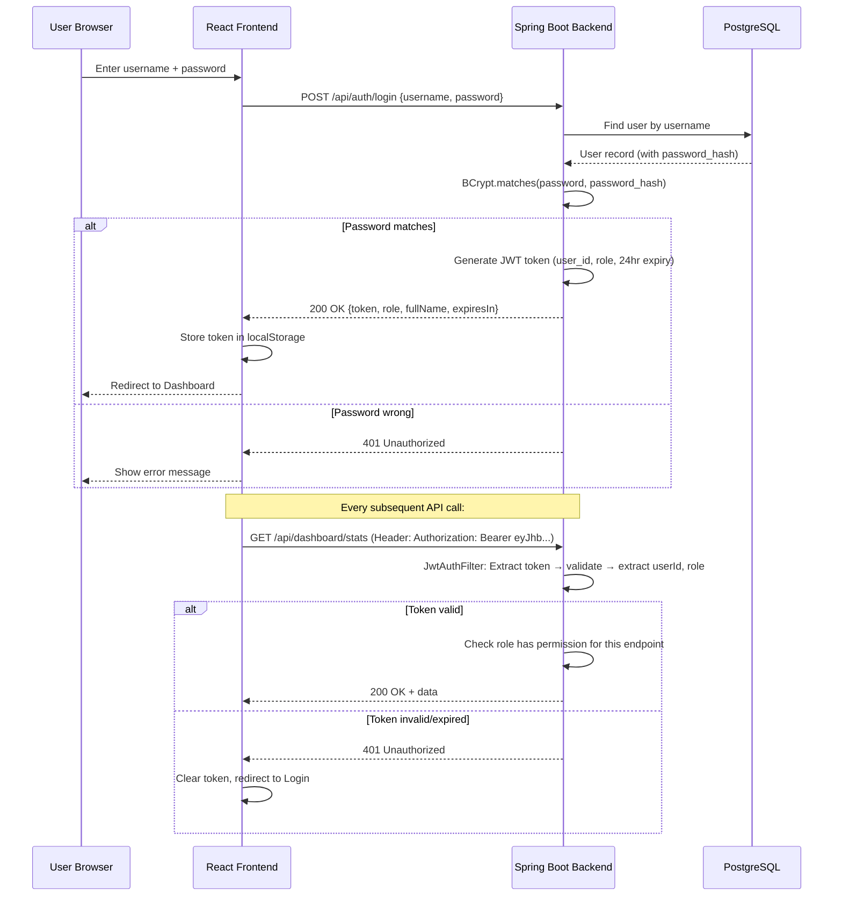

# 🔐 TraceIntel AG-1 — Security Plan

## Authentication: JWT Token Flow



---

## JWT Token Structure

```
Header:   { "alg": "HS256", "typ": "JWT" }
Payload:  {
            "sub": "3",                    ← user id
            "username": "operator1",
            "role": "OPERATOR",
            "fullName": "Rajesh Kumar",
            "iat": 1698408000,             ← issued at
            "exp": 1698494400              ← expires (24 hours later)
          }
Signature: HMACSHA256(header + "." + payload, SECRET_KEY)

Full Token: eyJhbGciOiJIUzI1NiJ9.eyJzdWIiOiIzIi...
```

| Setting | Value | Why |
|---------|-------|-----|
| Algorithm | HS256 | Simple, fast, sufficient for single-server |
| Secret Key | 256-bit key in application.yml | Must be ≥256 bits for HS256 |
| Expiry | 24 hours (86400000 ms) | Long enough for full shift |
| Storage | localStorage | Simple, works across tabs |

---

## Password Security

| Aspect | Implementation |
|--------|---------------|
| Hashing | BCrypt (Spring Security default) |
| Salt | Auto-generated per password (BCrypt built-in) |
| Strength | 10 rounds (default) |
| Storage | `users.password_hash` column |
| Plaintext | NEVER stored — only hash |

```
Input:     "pass123"
BCrypt:    "$2a$10$N9qo8uLOickgx2ZMRZoMyeIjZAgcfl7p92ldGxad68LJZdL17lhWy"
                 │    │
                 │    └── 10 rounds
                 └── BCrypt version 2a
```

---

## RBAC Access Matrix ⭐

> **Every role × every endpoint. Exactly who can do what.**

### Core Feature Endpoints

| Endpoint | ADMIN | OPERATOR | SUPERVISOR | QE | MANAGER |
|----------|-------|----------|------------|-----|---------|
| `POST /api/auth/login` | ✅ | ✅ | ✅ | ✅ | ✅ |
| `POST /api/auth/register` | ✅ | ❌ | ❌ | ❌ | ❌ |
| `GET /api/dashboard/*` | ✅ | ✅ | ✅ | ✅ | ✅ |
| `POST /api/scan/validate` | ✅ | ✅ | ✅ | ❌ | ❌ |
| `POST /api/scan/material-lot` | ✅ | ✅ | ✅ | ❌ | ❌ |
| `GET /api/scan/events` | ✅ | ✅ | ✅ | ❌ | ❌ |
| `POST /api/trace/forward` | ✅ | ❌ | ✅ | ✅ | ✅ |
| `POST /api/trace/backward` | ✅ | ❌ | ✅ | ✅ | ✅ |
| `GET /api/trace/history` | ✅ | ❌ | ❌ | ✅ | ✅ |
| `POST /api/holds/request` | ✅ | ❌ | ✅ | ✅ | ❌ |
| `PUT /api/holds/{id}/approve` | ✅ | ❌ | ❌ | ✅ | ✅ |
| `GET /api/holds` | ✅ | ❌ | ✅ | ✅ | ✅ |

### Shipment Endpoints

| Endpoint | ADMIN | OPERATOR | SUPERVISOR | QE | MANAGER |
|----------|-------|----------|------------|-----|---------|
| `GET /api/shipments` | ✅ | ✅ | ✅ | ❌ | ❌ |
| `POST /api/shipments` | ✅ | ❌ | ✅ | ❌ | ❌ |
| `POST /api/shipments/{id}/items` | ✅ | ✅ | ✅ | ❌ | ❌ |

### Admin Endpoints

| Endpoint | ADMIN | OPERATOR | SUPERVISOR | QE | MANAGER |
|----------|-------|----------|------------|-----|---------|
| `*/api/admin/parts` | ✅ | ❌ | ❌ | ❌ | ❌ |
| `*/api/admin/bom` | ✅ | ❌ | ❌ | ❌ | ❌ |
| `*/api/admin/suppliers` | ✅ | ❌ | ❌ | ❌ | ❌ |
| `*/api/admin/machines` | ✅ | ❌ | ❌ | ❌ | ❌ |
| `*/api/admin/customers` | ✅ | ❌ | ❌ | ❌ | ❌ |
| `*/api/admin/users` | ✅ | ❌ | ❌ | ❌ | ❌ |
| `*/api/admin/vin/*` | ✅ | ❌ | ❌ | ❌ | ❌ |
| `GET /api/audit/logs` | ✅ | ❌ | ❌ | ❌ | ✅ |

---

## Spring Security Filter Chain

```
HTTP Request
    │
    ▼
┌──────────────────────────────┐
│  1. CORS Filter              │  ← Allow localhost:5173
│     (CorsConfigurationSource)│
└──────────┬───────────────────┘
           │
           ▼
┌──────────────────────────────┐
│  2. JWT Authentication Filter │  ← Extract + validate JWT token
│     (OncePerRequestFilter)    │
│                               │
│  - Read Authorization header  │
│  - Extract Bearer token       │
│  - Validate signature + expiry│
│  - Load user + role from token│
│  - Set SecurityContext        │
└──────────┬───────────────────┘
           │
           ▼
┌──────────────────────────────┐
│  3. Authorization Check       │  ← Check role permissions
│     (SecurityFilterChain)     │
│                               │
│  - /api/auth/** → permitAll   │
│  - /api/admin/** → ADMIN only │
│  - /api/scan/** → OPERATOR+   │
│  - /api/trace/** → QE+        │
│  - /api/holds/** → QE+SUPER+  │
│  - everything else → authenticated │
└──────────┬───────────────────┘
           │
           ▼
┌──────────────────────────────┐
│  4. Controller Method         │  ← Handle request
│     (@PreAuthorize optional)  │
└──────────────────────────────┘
```

---

## Security Config Summary

```
SecurityConfig Rules:
────────────────────────────────────
/api/auth/**          → permitAll (no token needed)
/api/dashboard/**     → authenticated (any role)
/api/scan/**          → ADMIN, OPERATOR, SUPERVISOR
/api/trace/**         → ADMIN, SUPERVISOR, QUALITY_ENGINEER, MANAGER
/api/holds/**         → ADMIN, SUPERVISOR, QUALITY_ENGINEER, MANAGER
/api/shipments/**     → ADMIN, OPERATOR, SUPERVISOR
/api/admin/**         → ADMIN only
/api/audit/**         → ADMIN, MANAGER
Everything else       → authenticated

Session:              STATELESS (no server session, JWT only)
CSRF:                 DISABLED (API-only, no forms)
Password Encoder:     BCryptPasswordEncoder
```

---

## CORS Configuration

```
Allowed Origins:     http://localhost:5173 (Vite dev server)
                     http://localhost:3000 (alternate)
Allowed Methods:     GET, POST, PUT, DELETE, OPTIONS
Allowed Headers:     * (all)
Allow Credentials:   true
Max Age:             3600 seconds (1 hour preflight cache)
```

---

## Input Validation

| Field | Validation | Annotation |
|-------|-----------|------------|
| username | 3-50 chars, not blank | `@Size(min=3, max=50)` `@NotBlank` |
| password | 6-100 chars, not blank | `@Size(min=6, max=100)` `@NotBlank` |
| serialInput | Not blank, max 100 chars | `@NotBlank` `@Size(max=100)` |
| batchId | Not null, positive | `@NotNull` `@Positive` |
| lotId | Not null, positive | `@NotNull` `@Positive` |
| reason (hold) | Not blank, 10-500 chars | `@NotBlank` `@Size(min=10, max=500)` |
| partNumber | Not blank, pattern match | `@Pattern(regexp="^MTH-[A-Z]{2}-\\d{3}$")` |
| email | Valid email format | `@Email` |
| VIN | Exactly 17 chars | `@Size(min=17, max=17)` |

---

## Business Logic Security Rules

| Rule | Where Enforced | Error |
|------|---------------|-------|
| Two-person approval: requester ≠ approver | HoldServiceImpl.java | `InvalidApprovalException` |
| Manual entry needs supervisor approval | ScanServiceImpl.java | `result = BLOCKED, reason = MANUAL_ENTRY_NOT_APPROVED` |
| Can't approve already-resolved hold | HoldServiceImpl.java | `HoldAlreadyResolvedException` |
| Audit log for every state change | AuditService (auto) | Logged to audit_logs table |
