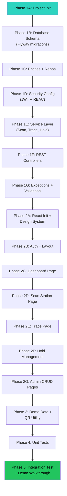

# TraceIntel AG-1 — Implementation Plan

## Goal Description

Build a **fully working, interview-ready** full-stack manufacturing traceability application for an auto-parts plant (Motherson). The system stops wrong parts on the production line and traces defective lots forward to affected batches, shipments, customers, and VINs — all from records created by scans during production.

**Tech Stack**: React (Vite) + Java 21 + Spring Boot 3.x + PostgreSQL + Spring Security (JWT)

**Design**: Premium dark-theme industrial UI inspired by Motionsite.ai — glassmorphism, scroll animations, gradient glows, micro-interactions.

---

## User Review Required

> [!IMPORTANT]
> **PostgreSQL Setup**: You need PostgreSQL installed and running locally. The plan assumes a database named `traceintel` on `localhost:5432`. Confirm your PostgreSQL credentials (username/password).

> [!IMPORTANT]
> **Java 21 + Maven**: You need JDK 21 and Maven installed. The plan uses Spring Boot 3.4.x which requires Java 17+.

> [!WARNING]
> **No Docker**: Per your request, everything runs locally (no containerization). You'll need Node.js 18+ for the React frontend.

---

## Open Questions

> [!IMPORTANT]
> **PostgreSQL Credentials**: What username and password do you use for your local PostgreSQL? The default plan uses `postgres` / `postgres`.

> [!IMPORTANT]
> **Port Preferences**: Backend on `8080`, Frontend on `5173` (Vite default). Any conflicts?

---

## Project Structure Overview

```
Traceintel AG-1/
├── backend/                          # Spring Boot application
│   ├── pom.xml
│   └── src/
│       ├── main/
│       │   ├── java/com/traceintel/
│       │   │   ├── TraceIntelApplication.java
│       │   │   ├── config/           # Security, JWT, CORS, WebConfig
│       │   │   ├── controller/       # REST controllers
│       │   │   ├── dto/              # Request/Response DTOs
│       │   │   ├── entity/           # JPA entities
│       │   │   ├── enums/            # Role, LotStatus, ScanResult enums
│       │   │   ├── exception/        # Custom exceptions + GlobalExceptionHandler
│       │   │   ├── repository/       # Spring Data JPA repositories
│       │   │   ├── service/          # Service interfaces
│       │   │   │   └── impl/         # Service implementations
│       │   │   ├── security/         # JWT filter, UserDetailsService
│       │   │   └── util/             # QR generation, CSV parser, helpers
│       │   └── resources/
│       │       ├── application.yml
│       │       └── db/migration/     # Flyway SQL migrations
│       └── test/
│           └── java/com/traceintel/  # JUnit + Mockito tests
│
└── frontend/                         # React (Vite) application
    ├── package.json
    ├── vite.config.js
    ├── index.html
    └── src/
        ├── main.jsx
        ├── App.jsx
        ├── index.css                 # Global design system (dark theme)
        ├── api/                      # Axios instance, API service modules
        ├── auth/                     # AuthContext, ProtectedRoute, LoginPage
        ├── components/               # Shared UI components
        │   ├── Sidebar.jsx
        │   ├── TopBar.jsx
        │   ├── Card.jsx
        │   ├── Table.jsx
        │   ├── Modal.jsx
        │   ├── StatusBadge.jsx
        │   ├── AnimatedCounter.jsx
        │   └── QRScanner.jsx         # html5-qrcode wrapper
        ├── pages/
        │   ├── Dashboard.jsx         # KPI overview with animated counters
        │   ├── ScanStation.jsx       # Scan & validate page
        │   ├── TracePage.jsx         # Forward trace
        │   ├── BackwardTracePage.jsx # Backward trace (VIN → lot)
        │   ├── HoldManagement.jsx    # Hold request + approval
        │   ├── admin/                # Admin CRUD pages
        │   │   ├── PartsManager.jsx
        │   │   ├── BOMManager.jsx
        │   │   ├── SuppliersManager.jsx
        │   │   ├── MachinesManager.jsx
        │   │   ├── CustomersManager.jsx
        │   │   ├── UsersManager.jsx
        │   │   └── VINImport.jsx
        │   ├── ShipmentPage.jsx
        │   └── AuditLog.jsx
        └── hooks/                    # useAuth, useFetch, useAnimation
```

---

## Proposed Changes

### Phase 1: Backend Foundation

#### Database Schema (Flyway Migrations)

18 tables, normalized with proper PK/FK/indexes/constraints.

```sql
-- V1__init_schema.sql

-- ═══════════════════════════════════════
-- ENUM TYPES
-- ═══════════════════════════════════════
CREATE TYPE role_type AS ENUM ('ADMIN','OPERATOR','SUPERVISOR','QUALITY_ENGINEER','MANAGER');
CREATE TYPE lot_status AS ENUM ('OK','ON_HOLD','REJECTED');
CREATE TYPE scan_result AS ENUM ('ACCEPTED','BLOCKED');
CREATE TYPE hold_status AS ENUM ('REQUESTED','APPROVED','REJECTED');
CREATE TYPE shift_type AS ENUM ('DAY','NIGHT','GENERAL');

-- ═══════════════════════════════════════
-- CORE TABLES
-- ═══════════════════════════════════════

CREATE TABLE roles (
    id              BIGSERIAL PRIMARY KEY,
    name            role_type NOT NULL UNIQUE,
    description     VARCHAR(255),
    created_at      TIMESTAMP DEFAULT NOW(),
    updated_at      TIMESTAMP DEFAULT NOW()
);

CREATE TABLE users (
    id              BIGSERIAL PRIMARY KEY,
    username        VARCHAR(50) NOT NULL UNIQUE,
    password_hash   VARCHAR(255) NOT NULL,
    full_name       VARCHAR(100) NOT NULL,
    email           VARCHAR(100) UNIQUE,
    role_id         BIGINT NOT NULL REFERENCES roles(id),
    active          BOOLEAN DEFAULT TRUE,
    created_at      TIMESTAMP DEFAULT NOW(),
    updated_at      TIMESTAMP DEFAULT NOW()
);

CREATE TABLE suppliers (
    id              BIGSERIAL PRIMARY KEY,
    code            VARCHAR(20) NOT NULL UNIQUE,
    name            VARCHAR(150) NOT NULL,
    contact_email   VARCHAR(100),
    phone           VARCHAR(30),
    address         TEXT,
    created_at      TIMESTAMP DEFAULT NOW(),
    updated_at      TIMESTAMP DEFAULT NOW()
);

CREATE TABLE customers (
    id              BIGSERIAL PRIMARY KEY,
    code            VARCHAR(20) NOT NULL UNIQUE,
    name            VARCHAR(150) NOT NULL,
    contact_email   VARCHAR(100),
    phone           VARCHAR(30),
    address         TEXT,
    created_at      TIMESTAMP DEFAULT NOW(),
    updated_at      TIMESTAMP DEFAULT NOW()
);

CREATE TABLE machines (
    id              BIGSERIAL PRIMARY KEY,
    code            VARCHAR(20) NOT NULL UNIQUE,
    name            VARCHAR(100) NOT NULL,
    station         VARCHAR(50),
    location        VARCHAR(100),
    active          BOOLEAN DEFAULT TRUE,
    created_at      TIMESTAMP DEFAULT NOW(),
    updated_at      TIMESTAMP DEFAULT NOW()
);

CREATE TABLE parts (
    id              BIGSERIAL PRIMARY KEY,
    part_number     VARCHAR(50) NOT NULL UNIQUE,
    name            VARCHAR(150) NOT NULL,
    description     TEXT,
    cost_per_part   NUMERIC(12,2) DEFAULT 0,
    parts_per_vehicle INTEGER DEFAULT 1,
    scrap_cost      NUMERIC(12,2) DEFAULT 0,
    rework_cost     NUMERIC(12,2) DEFAULT 0,
    created_at      TIMESTAMP DEFAULT NOW(),
    updated_at      TIMESTAMP DEFAULT NOW()
);

-- ═══════════════════════════════════════
-- BOM (Bill of Materials) — supports multi-level
-- ═══════════════════════════════════════

CREATE TABLE bom_items (
    id              BIGSERIAL PRIMARY KEY,
    parent_part_id  BIGINT NOT NULL REFERENCES parts(id),
    child_part_id   BIGINT NOT NULL REFERENCES parts(id),
    quantity        NUMERIC(10,3) NOT NULL DEFAULT 1,
    level           INTEGER NOT NULL DEFAULT 1,
    created_at      TIMESTAMP DEFAULT NOW(),
    updated_at      TIMESTAMP DEFAULT NOW(),
    UNIQUE(parent_part_id, child_part_id)
);

-- ═══════════════════════════════════════
-- PRODUCTION TABLES
-- ═══════════════════════════════════════

CREATE TABLE material_lots (
    id              BIGSERIAL PRIMARY KEY,
    lot_number      VARCHAR(50) NOT NULL UNIQUE,
    supplier_id     BIGINT NOT NULL REFERENCES suppliers(id),
    part_id         BIGINT REFERENCES parts(id),
    received_date   DATE NOT NULL,
    expiry_date     DATE,
    status          lot_status NOT NULL DEFAULT 'OK',
    quantity        NUMERIC(12,2),
    unit            VARCHAR(20) DEFAULT 'pcs',
    created_at      TIMESTAMP DEFAULT NOW(),
    updated_at      TIMESTAMP DEFAULT NOW()
);

CREATE TABLE production_batches (
    id              BIGSERIAL PRIMARY KEY,
    batch_number    VARCHAR(50) NOT NULL UNIQUE,
    part_id         BIGINT NOT NULL REFERENCES parts(id),
    machine_id      BIGINT NOT NULL REFERENCES machines(id),
    operator_id     BIGINT NOT NULL REFERENCES users(id),
    shift           shift_type NOT NULL DEFAULT 'DAY',
    start_time      TIMESTAMP NOT NULL,
    end_time        TIMESTAMP,
    quantity         INTEGER NOT NULL DEFAULT 0,
    created_at      TIMESTAMP DEFAULT NOW(),
    updated_at      TIMESTAMP DEFAULT NOW()
);

CREATE TABLE batch_material_consumption (
    id              BIGSERIAL PRIMARY KEY,
    batch_id        BIGINT NOT NULL REFERENCES production_batches(id),
    lot_id          BIGINT NOT NULL REFERENCES material_lots(id),
    quantity_used   NUMERIC(12,2),
    recorded_at     TIMESTAMP DEFAULT NOW(),
    UNIQUE(batch_id, lot_id)
);

CREATE TABLE serial_numbers (
    id              BIGSERIAL PRIMARY KEY,
    serial          VARCHAR(100) NOT NULL UNIQUE,
    part_id         BIGINT NOT NULL REFERENCES parts(id),
    batch_id        BIGINT NOT NULL REFERENCES production_batches(id),
    produced_at     TIMESTAMP DEFAULT NOW(),
    created_at      TIMESTAMP DEFAULT NOW()
);

CREATE TABLE scan_events (
    id              BIGSERIAL PRIMARY KEY,
    serial_number_id BIGINT REFERENCES serial_numbers(id),
    serial_input    VARCHAR(100) NOT NULL,
    batch_id        BIGINT REFERENCES production_batches(id),
    operator_id     BIGINT NOT NULL REFERENCES users(id),
    station         VARCHAR(50),
    result          scan_result NOT NULL,
    reason          TEXT,
    manual_entry    BOOLEAN DEFAULT FALSE,
    approved_by     BIGINT REFERENCES users(id),
    scanned_at      TIMESTAMP DEFAULT NOW()
);

-- ═══════════════════════════════════════
-- SHIPMENT TABLES
-- ═══════════════════════════════════════

CREATE TABLE shipments (
    id              BIGSERIAL PRIMARY KEY,
    shipment_number VARCHAR(50) NOT NULL UNIQUE,
    customer_id     BIGINT NOT NULL REFERENCES customers(id),
    shipped_date    DATE NOT NULL,
    notes           TEXT,
    created_at      TIMESTAMP DEFAULT NOW(),
    updated_at      TIMESTAMP DEFAULT NOW()
);

CREATE TABLE shipment_items (
    id              BIGSERIAL PRIMARY KEY,
    shipment_id     BIGINT NOT NULL REFERENCES shipments(id),
    batch_id        BIGINT NOT NULL REFERENCES production_batches(id),
    quantity        INTEGER NOT NULL DEFAULT 0,
    UNIQUE(shipment_id, batch_id)
);

-- ═══════════════════════════════════════
-- VIN LINK TABLE
-- ═══════════════════════════════════════

CREATE TABLE vehicle_links (
    id              BIGSERIAL PRIMARY KEY,
    vin             VARCHAR(17) NOT NULL,
    batch_id        BIGINT REFERENCES production_batches(id),
    serial_number_id BIGINT REFERENCES serial_numbers(id),
    customer_id     BIGINT REFERENCES customers(id),
    imported_at     TIMESTAMP DEFAULT NOW()
);
CREATE INDEX idx_vehicle_links_vin ON vehicle_links(vin);
CREATE INDEX idx_vehicle_links_batch ON vehicle_links(batch_id);

-- ═══════════════════════════════════════
-- QUALITY HOLD (Two-Person Approval)
-- ═══════════════════════════════════════

CREATE TABLE quality_holds (
    id              BIGSERIAL PRIMARY KEY,
    lot_id          BIGINT NOT NULL REFERENCES material_lots(id),
    requested_by    BIGINT NOT NULL REFERENCES users(id),
    request_reason  TEXT NOT NULL,
    status          hold_status NOT NULL DEFAULT 'REQUESTED',
    approved_by     BIGINT REFERENCES users(id),
    approval_notes  TEXT,
    requested_at    TIMESTAMP DEFAULT NOW(),
    resolved_at     TIMESTAMP
);

-- ═══════════════════════════════════════
-- TRACE RUN LOG
-- ═══════════════════════════════════════

CREATE TABLE trace_runs (
    id              BIGSERIAL PRIMARY KEY,
    lot_id          BIGINT REFERENCES material_lots(id),
    direction       VARCHAR(10) NOT NULL DEFAULT 'FORWARD',
    input_value     VARCHAR(100),
    result_json     JSONB,
    duration_ms     BIGINT NOT NULL,
    executed_by     BIGINT NOT NULL REFERENCES users(id),
    executed_at     TIMESTAMP DEFAULT NOW()
);

-- ═══════════════════════════════════════
-- AUDIT LOG
-- ═══════════════════════════════════════

CREATE TABLE audit_logs (
    id              BIGSERIAL PRIMARY KEY,
    user_id         BIGINT REFERENCES users(id),
    action          VARCHAR(50) NOT NULL,
    entity_type     VARCHAR(50),
    entity_id       BIGINT,
    details         TEXT,
    ip_address      VARCHAR(45),
    created_at      TIMESTAMP DEFAULT NOW()
);

-- ═══════════════════════════════════════
-- INDEXES (for trace performance)
-- ═══════════════════════════════════════

CREATE INDEX idx_bmc_lot ON batch_material_consumption(lot_id);
CREATE INDEX idx_bmc_batch ON batch_material_consumption(batch_id);
CREATE INDEX idx_shipment_items_batch ON shipment_items(batch_id);
CREATE INDEX idx_shipment_items_shipment ON shipment_items(shipment_id);
CREATE INDEX idx_serial_numbers_serial ON serial_numbers(serial);
CREATE INDEX idx_serial_numbers_batch ON serial_numbers(batch_id);
CREATE INDEX idx_scan_events_batch ON scan_events(batch_id);
CREATE INDEX idx_material_lots_status ON material_lots(status);
CREATE INDEX idx_production_batches_part ON production_batches(part_id);
CREATE INDEX idx_quality_holds_lot ON quality_holds(lot_id);
CREATE INDEX idx_audit_logs_user ON audit_logs(user_id);
CREATE INDEX idx_audit_logs_entity ON audit_logs(entity_type, entity_id);
```

---

#### [NEW] `backend/pom.xml`

Spring Boot 3.4.x with dependencies:
- `spring-boot-starter-web`
- `spring-boot-starter-data-jpa`
- `spring-boot-starter-security`
- `spring-boot-starter-validation`
- `postgresql` driver
- `flyway-core` + `flyway-database-postgresql`
- `jjwt-api/impl/jackson` (io.jsonwebtoken 0.12.x) for JWT
- `zxing-core` + `zxing-javase` for QR code generation
- `opencsv` for VIN CSV import
- `spring-boot-starter-test` + `mockito-core` for testing
- `lombok` for boilerplate reduction

---

#### [NEW] Entity Classes (Abstract Base Entity pattern)

```java
// BaseEntity.java — all entities extend this
@MappedSuperclass
public abstract class BaseEntity {
    @Id @GeneratedValue(strategy = GenerationType.IDENTITY)
    private Long id;

    @Column(name = "created_at", updatable = false)
    private LocalDateTime createdAt;

    @Column(name = "updated_at")
    private LocalDateTime updatedAt;

    @PrePersist
    protected void onCreate() { createdAt = updatedAt = LocalDateTime.now(); }

    @PreUpdate
    protected void onUpdate() { updatedAt = LocalDateTime.now(); }
}
```

**Entities** (18 total):
| Entity | Key Fields |
|--------|-----------|
| `Role` | name (enum), description |
| `User` | username, passwordHash, fullName, email, role |
| `Part` | partNumber, name, costPerPart, partsPerVehicle, scrapCost, reworkCost |
| `BomItem` | parentPart, childPart, quantity, level |
| `Supplier` | code, name, contactEmail |
| `Customer` | code, name, contactEmail |
| `Machine` | code, name, station, location |
| `MaterialLot` | lotNumber, supplier, part, status (enum), receivedDate |
| `ProductionBatch` | batchNumber, part, machine, operator, shift, startTime |
| `BatchMaterialConsumption` | batch, lot, quantityUsed |
| `SerialNumber` | serial (unique), part, batch |
| `ScanEvent` | serialInput, batch, operator, result (enum), reason, manualEntry |
| `Shipment` | shipmentNumber, customer, shippedDate |
| `ShipmentItem` | shipment, batch, quantity |
| `VehicleLink` | vin, batch, serialNumber, customer |
| `QualityHold` | lot, requestedBy, status (enum), approvedBy |
| `TraceRun` | lot, direction, resultJson (JSONB), durationMs |
| `AuditLog` | userId, action, entityType, entityId, details |

---

#### [NEW] Custom Exceptions + Global Handler

```java
// Exceptions (all extend RuntimeException)
├── PartNotFoundException
├── LotNotFoundException
├── BatchNotFoundException
├── CustomerNotFoundException
├── WrongPartException            // part not in BOM for production order
├── DuplicateSerialException      // same serial scanned twice
├── LotOnHoldException            // lot is ON_HOLD, scan blocked
├── InvalidApprovalException      // same person requests + approves hold

// GlobalExceptionHandler.java
@RestControllerAdvice
public class GlobalExceptionHandler {
    // Returns { "error": "...", "message": "...", "timestamp": "..." }
    // Maps each custom exception to the right HTTP status
}
```

---

#### [NEW] Security Configuration (JWT + RBAC)

```
config/
├── SecurityConfig.java          # SecurityFilterChain, CORS, stateless session
├── JwtAuthenticationFilter.java # OncePerRequestFilter, extracts JWT from header
├── JwtTokenProvider.java        # Generate / validate tokens (io.jsonwebtoken)
└── CustomUserDetailsService.java
```

**JWT Flow**:
1. `POST /api/auth/login` → username + password → returns `{ token, role, fullName }`
2. Every subsequent request carries `Authorization: Bearer <token>`
3. `JwtAuthenticationFilter` validates token, sets SecurityContext
4. Method-level security: `@PreAuthorize("hasRole('ADMIN')")` etc.

**Role → Endpoint Access Matrix**:

| Endpoint Group | ADMIN | OPERATOR | SUPERVISOR | QUALITY_ENGINEER | MANAGER |
|---|---|---|---|---|---|
| Admin CRUD (`/api/admin/*`) | ✅ | ❌ | ❌ | ❌ | ❌ |
| Scan (`/api/scan/*`) | ✅ | ✅ | ✅ | ❌ | ❌ |
| Trace (`/api/trace/*`) | ✅ | ❌ | ✅ | ✅ | ✅ |
| Hold (`/api/holds/*`) | ✅ | ❌ | ✅ | ✅ | ✅ |
| Shipment (`/api/shipments/*`) | ✅ | ✅ | ✅ | ❌ | ❌ |
| Dashboard (`/api/dashboard/*`) | ✅ | ✅ | ✅ | ✅ | ✅ |
| Audit Log (`/api/audit/*`) | ✅ | ❌ | ❌ | ❌ | ✅ |

---

#### [NEW] REST Controllers (12 controllers)

| Controller | Key Endpoints |
|------------|--------------|
| `AuthController` | `POST /api/auth/login`, `POST /api/auth/register` |
| `PartController` | CRUD `/api/admin/parts` |
| `BomController` | CRUD `/api/admin/bom` |
| `SupplierController` | CRUD `/api/admin/suppliers` |
| `MachineController` | CRUD `/api/admin/machines` |
| `CustomerController` | CRUD `/api/admin/customers` |
| `UserController` | CRUD `/api/admin/users` |
| `ScanController` | `POST /api/scan/validate` — the core scan validation |
| `TraceController` | `POST /api/trace/forward`, `POST /api/trace/backward` |
| `HoldController` | `POST /api/holds/request`, `PUT /api/holds/{id}/approve` |
| `ShipmentController` | CRUD `/api/shipments`, `POST /api/shipments/{id}/scan` |
| `VINImportController` | `POST /api/admin/vin/import` (CSV upload) |
| `DashboardController` | `GET /api/dashboard/stats` |
| `AuditLogController` | `GET /api/audit/logs` |

---

#### [NEW] Service Layer (Interface + Implementation pattern)

**Core Business Logic Services**:

##### ScanService — The Heart of the System

```java
public interface ScanService {
    ScanResultDto validateScan(ScanRequestDto request);
}

// Implementation: ScanServiceImpl.java
// Step 1: Find serial number (or create if first scan)
// Step 2: Check lot status → if ON_HOLD → BLOCKED + "Lot is on hold"
// Step 3: Check part against BOM for the production batch
//         → if wrong part → BLOCKED + "Part X is not in BOM for batch Y"
// Step 4: Check duplicate serial in same batch → BLOCKED + "Duplicate serial"
// Step 5: All checks pass → ACCEPTED
// Step 6: Record ScanEvent (accepted or blocked)
// Step 7: Record in AuditLog
```

##### TraceService — The Trace Button Logic

```java
public interface TraceService {
    TraceResultDto forwardTrace(Long lotId);
    BackwardTraceResultDto backwardTrace(String vinOrSerial);
}

// Forward trace implementation:
// 1. Find batches that consumed the lot (batch_material_consumption)
// 2. Split into: shipped batches (in shipment_items) vs. in-factory batches
// 3. For shipped: find shipments → customers
// 4. Find VINs linked to those batches (vehicle_links)
// 5. If no VIN data: estimate = affected_parts / parts_per_vehicle
// 6. Calculate loss = affected_parts × cost_per_part + scrap_cost + rework_cost
// 7. Save TraceRun with duration_ms
// 8. Return combined report as TraceResultDto

// Backward trace implementation:
// 1. Find VIN or serial in vehicle_links / serial_numbers
// 2. Find batch → lot → supplier
// 3. Return chain as BackwardTraceResultDto
```

##### HoldService — Two-Person Approval

```java
public interface HoldService {
    QualityHoldDto requestHold(HoldRequestDto request);
    QualityHoldDto approveHold(Long holdId, HoldApprovalDto approval);
}

// Validation: if requestedBy == approvedBy → throw InvalidApprovalException
// On approval: update lot status to ON_HOLD
// After this, ScanService checks will block any scan using this lot
```

---

### Phase 2: React Frontend

#### [NEW] `frontend/` — Vite + React

Initialize with:
```bash
npx -y create-vite@latest ./ -- --template react
```

**Key npm packages**:
- `react-router-dom` — routing
- `axios` — HTTP client
- `framer-motion` — scroll animations, page transitions, micro-interactions
- `recharts` — dashboard charts
- `html5-qrcode` — QR/barcode scanning from browser camera
- `react-hot-toast` — toast notifications
- `lucide-react` — icon library (same as Motionsite.ai uses)

---

#### Design System — Premium Dark Industrial Theme

Inspired by Motionsite.ai with an industrial manufacturing twist:

```css
/* index.css — Design Tokens */
:root {
  /* Dark industrial palette */
  --bg-primary: #0a0a0f;
  --bg-secondary: #111118;
  --bg-card: rgba(17, 17, 24, 0.7);
  --bg-surface: rgba(255, 255, 255, 0.03);

  /* Accent: Electric teal (matches Motionsite) + warning orange */
  --accent-primary: #2dd4bf;        /* Teal */
  --accent-secondary: #8b5cf6;      /* Purple */
  --accent-danger: #ef4444;          /* Red — for BLOCKED */
  --accent-success: #22c55e;         /* Green — for ACCEPTED */
  --accent-warning: #f59e0b;         /* Amber — for ON_HOLD */

  /* Glassmorphism */
  --glass-bg: rgba(255, 255, 255, 0.04);
  --glass-border: rgba(255, 255, 255, 0.08);
  --glass-blur: 12px;

  /* Text */
  --text-primary: #f4f4f5;
  --text-secondary: #a1a1aa;
  --text-muted: #71717a;

  /* Glow effects */
  --glow-teal: 0 0 20px rgba(45, 212, 191, 0.3);
  --glow-purple: 0 0 20px rgba(139, 92, 246, 0.3);
  --glow-red: 0 0 20px rgba(239, 68, 68, 0.4);
  --glow-green: 0 0 20px rgba(34, 197, 94, 0.3);

  /* Typography */
  --font-sans: 'Inter', system-ui, sans-serif;

  /* Borders */
  --radius-sm: 8px;
  --radius-md: 12px;
  --radius-lg: 16px;
  --radius-xl: 24px;
}
```

**Key UI patterns** (from Motionsite.ai):
- **Glassmorphic cards**: `backdrop-filter: blur(12px)`, semi-transparent backgrounds, subtle borders
- **Gradient glows on hover**: `box-shadow: 0 0 30px rgba(45,212,191,0.15)` 
- **Scroll-triggered animations**: Elements fade up with `framer-motion` `whileInView`
- **Animated counters**: Dashboard KPI numbers count up on mount
- **Smooth page transitions**: Fade + slide with `AnimatePresence`
- **Radial gradient backgrounds**: Subtle color washes behind sections

---

#### Frontend Pages & Components

##### Dashboard (`/dashboard`)
```
┌─────────────────────────────────────────────────────────────┐
│  ┌─────────┐ ┌─────────┐ ┌─────────┐ ┌─────────┐          │
│  │ Total   │ │ Scans   │ │ Blocked │ │ Active  │          │
│  │ Batches │ │ Today   │ │ Today   │ │ Holds   │          │
│  │  ↗ 247  │ │  ↗ 1,834│ │  ↗ 12   │ │  ⚠ 3    │          │
│  └─────────┘ └─────────┘ └─────────┘ └─────────┘          │
│                                                             │
│  ┌─────────────────────────┐ ┌─────────────────────────┐   │
│  │ Scan Activity (7 days) │ │ Block Reasons Breakdown │   │
│  │ [Area Chart]            │ │ [Donut Chart]           │   │
│  └─────────────────────────┘ └─────────────────────────┘   │
│                                                             │
│  ┌──────────────────────────────────────────────────────┐   │
│  │ Recent Scan Events (live table)                      │   │
│  │ Serial | Part | Result | Reason | Time               │   │
│  └──────────────────────────────────────────────────────┘   │
└─────────────────────────────────────────────────────────────┘
```

##### Scan Station (`/scan`)
The hero page for the demo. Two modes:
1. **Text input**: Type/paste serial number → hit Enter → instant validation result
2. **Camera scan** (optional button): Opens `html5-qrcode` camera feed → reads QR → auto-validates

Validation result appears as a large animated card:
- ✅ **ACCEPTED** — green glow, check animation
- ❌ **BLOCKED** — red glow, shake animation, reason displayed prominently

##### Trace Page (`/trace`)
1. Select defective lot from dropdown
2. Press **🔍 Trace** button
3. Animated loading → results appear:
   - Affected Batches table
   - Affected Shipments table
   - Affected Customers table
   - Affected VINs table
   - In-Factory (unshipped) Batches highlighted
   - **Trace Time**: "Completed in 47ms" with stopwatch animation
   - **Estimates section** (if no VIN data): estimated vehicles, estimated loss

##### Hold Management (`/holds`)
- **Request Hold**: Select lot → enter reason → submit
- **Pending Approvals**: List of holds with `REQUESTED` status
- **Approve/Reject**: Different user clicks approve → lot status → ON_HOLD
- Validation: system blocks if same user tries to approve their own request

##### Admin Pages (`/admin/*`)
Standard CRUD with glassmorphic tables:
- Parts, BOM, Suppliers, Machines, Customers, Users
- VIN Import: File upload (CSV) → preview table → confirm import

---

### Phase 3: Integration & Demo Data

#### [NEW] `V2__seed_demo_data.sql`

Realistic demo data for Motherson auto-parts context:

```
• 5 roles (pre-seeded)
• 8 users (admin, 3 operators, supervisor, 2 quality engineers, manager)
• 5 suppliers (steel, plastic, rubber, electronics, fasteners)
• 4 customers (Maruti Suzuki, Tata Motors, Hyundai, Mahindra)
• 6 machines (Injection Molding M1, CNC Lathe M2, Press M3, Assembly A1, etc.)
• 10 parts (Door Handle Assembly, Wiring Harness, Bumper Guard, etc.)
• BOM items linking parts
• 8 material lots (with status OK and 1 ON_HOLD for demo)
• 6 production batches
• Batch-material consumption links
• 30 serial numbers
• 20 scan events (mix of accepted and blocked)
• 3 shipments with items
• 15 VIN links (realistic 17-char VINs)
• 2 quality holds (1 pending, 1 approved)
• 3 trace runs
```

#### [NEW] QR Code Generation Utility

```java
// QRCodeUtil.java — uses ZXing
public class QRCodeUtil {
    public static byte[] generateQRCode(String text, int width, int height) {
        // Returns PNG byte array for the given serial number
    }
}
```

Endpoint: `GET /api/qr/{serial}` → returns QR code image (for testing/demo).

---

### Phase 4: Unit Tests

#### [NEW] Test Classes (JUnit 5 + Mockito)

| Test Class | Test Cases |
|-----------|-----------|
| `ScanServiceTest` | ✅ Wrong part is blocked with reason |
| | ✅ Duplicate serial is rejected |
| | ✅ Part from ON_HOLD lot is blocked |
| | ✅ Valid part is accepted |
| | ✅ Manual entry requires supervisor approval |
| `HoldServiceTest` | ✅ Same person requesting and approving throws `InvalidApprovalException` |
| | ✅ Different person can approve successfully |
| | ✅ Lot status changes to ON_HOLD after approval |
| `TraceServiceTest` | ✅ Forward trace returns expected batches, customers, VINs |
| | ✅ Backward trace from VIN returns correct lot |
| | ✅ Trace time is recorded |
| `EstimateServiceTest` | ✅ Vehicle estimate = affected_parts / parts_per_vehicle |
| | ✅ Loss estimate = parts × cost + scrap + rework |

---

## Execution Order (Build Phases)



**Estimated total files**: ~80 Java files + ~35 React files + 2 SQL migrations

---

## Verification Plan

### Automated Tests

```bash
# Backend tests
cd backend
mvn test

# Specific test classes
mvn test -Dtest=ScanServiceTest
mvn test -Dtest=HoldServiceTest
mvn test -Dtest=TraceServiceTest
mvn test -Dtest=EstimateServiceTest
```

### Manual Verification

1. **Start PostgreSQL** → Create `traceintel` database
2. **Start Backend**: `cd backend && mvn spring-boot:run`
3. **Start Frontend**: `cd frontend && npm run dev`
4. **Demo Flow** (matches the 3-4 minute demo sequence):
   - Login as operator → Go to Scan Station
   - Scan a wrong part → see **BLOCKED** with reason
   - Login as quality engineer → Request hold on a lot
   - Login as supervisor → Approve the hold
   - Go to Trace page → Select the held lot → Press Trace
   - See affected batches, customers, VINs
   - See trace time (e.g., "47ms")
   - Verify the backward trace from a VIN
5. **Check all CRUD** admin pages work
6. **Check JWT security** — unauthenticated requests are rejected
